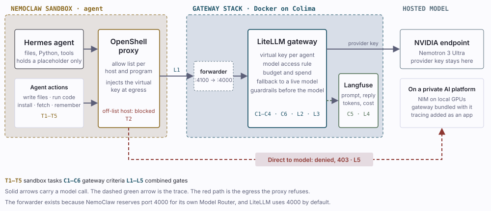

# governed-agent-lab

One AI agent, three controls: a **sandbox** decides what the agent may touch, a **gateway** decides which model it may call and at what cost, and **tracing** records what was said and what it cost.

This lab wires them together on a laptop. A Hermes agent runs inside an NVIDIA NemoClaw (OpenShell) sandbox, every model call leaves through the sandbox proxy, passes a LiteLLM gateway, and lands in Langfuse. It mirrors the application path of private-cloud AI platforms that put an LLM gateway in front of their models.



## What each control answers

| Control | Question it answers | Where |
|---|---|---|
| Sandbox (NemoClaw / OpenShell) | What may the agent touch: files, hosts, programs? Which key may it hold? | `sandbox/` |
| Gateway (LiteLLM) | Which model may this agent call, within what budget, with which filters, and what if a model is down? | `gateway/` |
| Tracing (Langfuse) | What did the agent send and receive, how many tokens, at what cost and latency? | `gateway/langfuse.yml` |

Two key layers: the provider key lives only in LiteLLM; the agent's virtual key lives only in the OpenShell proxy, which injects it at egress. Inside the sandbox the agent sees a placeholder.

## Gates

Sixteen pass/fail gates in three groups. Full pass marks and results: [docs/GATES.md](docs/GATES.md).

| Group | What it tests | Gates | Latest result |
|---|---|---|---|
| T · sandbox tasks | Same agent and model, bare vs inside the sandbox, five tasks | T1–T5 | 4 pass; T5 (injection) not reached: the model refused first. Source: [research-hermes-nemoclaw-sandbox](https://github.com/frankbesch/research-hermes-nemoclaw-sandbox) |
| C · gateway criteria | Virtual keys, model access, fallback, budget stop, tracing, guardrails; no agent | C1–C6 | 6 of 6 pass, 2026-11-08 |
| L · combined | The sandboxed agent calling models only through the gateway | L1–L5 | 5 of 5 pass, 2026-11-08 |

What the combined run adds over the separate tests: the injection probe reached a control (the gateway blocked it before the model), cost is visible per agent task rather than per call, and a direct call from the sandbox to the model is refused, so the gateway can't be bypassed.

## Findings

Details and evidence: [docs/FINDINGS.md](docs/FINDINGS.md).

1. Per-key guardrails need LiteLLM Enterprise; the open-source edition supports per-request or gateway-wide guardrails only.
2. LiteLLM reserves each call's worst-case cost before sending it, so an agent that makes parallel calls can get a 422 below its budget unless requests set `max_tokens`.
3. A gateway-wide filter screens every call an agent makes, including its side calls, and their false positives.
4. NemoClaw reserves port 4000 for its own model router, which is LiteLLM's default port; `sandbox/fwd.py` bridges 4100 to 4000.

## Run it

Requirements: macOS with Colima (or another Docker engine), NemoClaw/OpenShell installed, an NVIDIA API key.

```bash
cp gateway/.env.example gateway/.env      # fill in every value
bash gateway/up.sh                         # LiteLLM :4000, Langfuse :3000, bound to 127.0.0.1
python3 gateway/test_gateway.py            # 10 checks
bash gates/run-c-gates.sh                  # C1-C6
python3 -I sandbox/fwd.py                  # keep running: 127.0.0.1:4100 -> :4000
bash sandbox/onboard-agent.sh              # needs sandbox/.agent-key: a LiteLLM virtual key
bash gates/run-l-gates.sh && bash gates/run-l-gates-2.sh   # L1-L5
```

`SANDBOX`, `AGENT_KEY_ALIAS`, `COMPOSE_PROJECT`, `NVIDIA_API_KEY`, and `NVIDIA_KEY_FILE` override the defaults. Results land in `results/<date>/`.

## Limits

- A laptop lab with synthetic prompts. Not production, not hardened, not a security claim.
- Prices in `gateway/config.yaml` are made up so spend tracking is visible. Don't quote them.
- One run per gate. NemoClaw is alpha software.
- Not shown here: GPU scheduling, Kubernetes operations, fleet management, observability platforms.
- LiteLLM is pinned to v1.106.6. LiteLLM has had serious security advisories; check the project's advisories before reusing this setup.

## How this was built

Built with an AI coding agent under my direction. The runs in `results/2026-11-08/` were executed by the agent; I review and re-run gates before citing a result.

No license is granted yet; all rights reserved.
